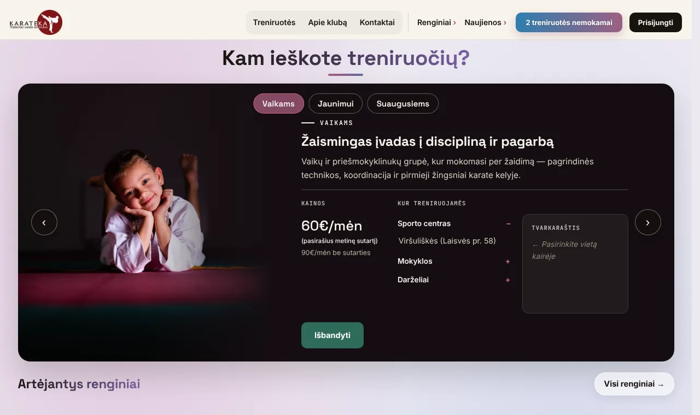
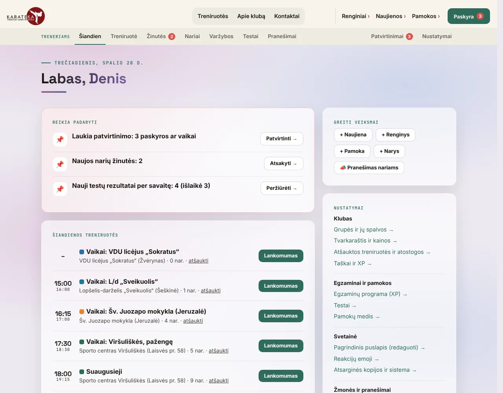
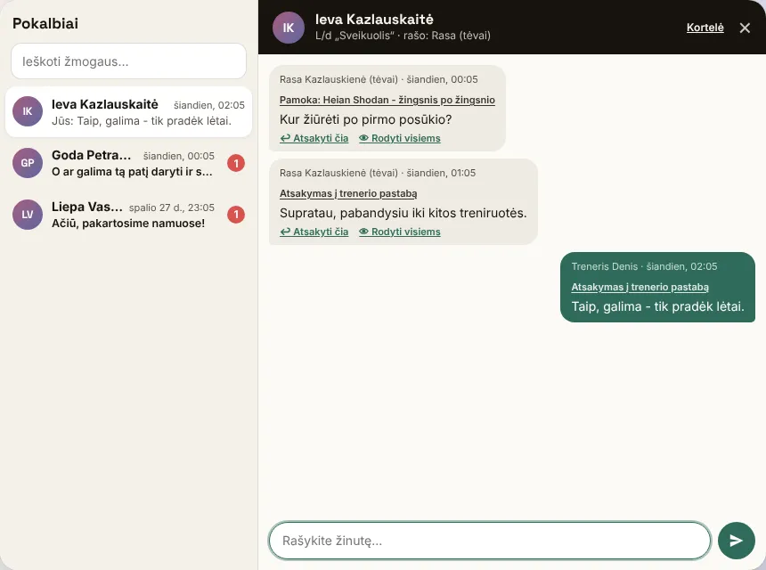
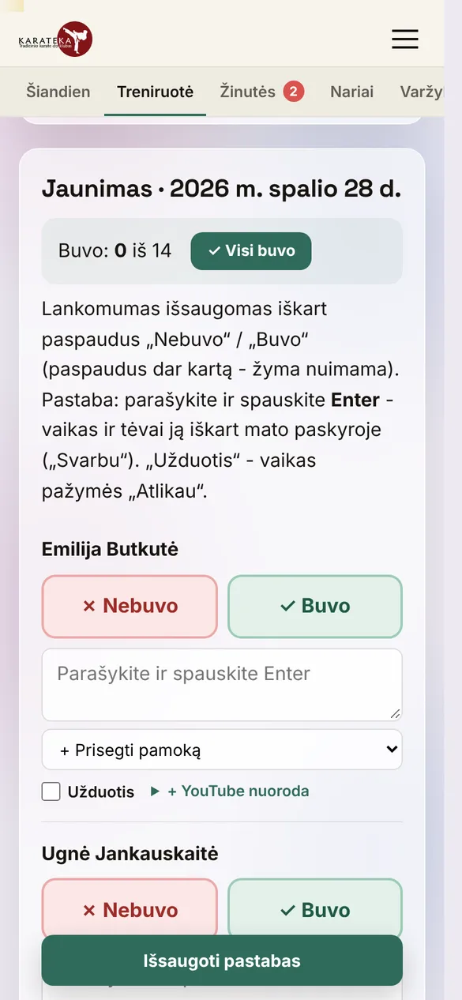
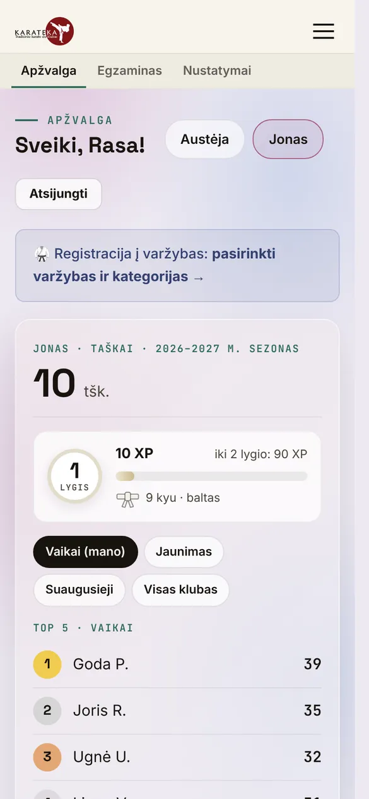

# karateka.lt

[](https://github.com/DeividasBalinskis/karateka/actions/workflows/tests.yml)

Website and member system for **VšĮ Karate Ateitis**, a traditional karate-do club in Vilnius, Lithuania.

Live site: [karateka.lt](https://karateka.lt). The member system is in staging and will replace the current site.



| Coach dashboard | Chat with members |
|---|---|
|  |  |

| Attendance on a phone | Parent account on a phone |
|---|---|
|  |  |

Screenshots use generated demo data.

## Features

**Public site**
- Home page built from blocks that the admin edits in place: texts, photos, order, menu links, instructors, partner logos
- Groups, prices and weekly schedules for kids, youth and adults; cancelled trainings and holidays are shown above the schedule
- Event calendar (exams, competitions, seminars, camps) with a page per event, map and registration
- News with photos and YouTube videos, emoji reactions (including belt colors and referee flags)
- Trial training sign-up form

**Members and parents**
- Family accounts: one parent account manages several children; children under 14 are activated only after a parent confirms by e-mail (GDPR)
- "Important" section: invitations with a registration countdown, coach notes, sent lessons, replies and announcements — each disappears once handled
- Event registration with deadlines; after the deadline a member can ask to join late and the coach approves
- Season points and ranking, lifetime XP and levels, exam program with "I can do this" requests that the coach approves, quizzes
- Chat with the head coach from any page, comments on events, news and lessons (optionally anonymous towards other members)
- Installable on a phone (web app manifest, service worker, offline page)

**Coaches** (mobile-first, used in the gym)
- Dashboard: everything that needs attention in one list, today's trainings and upcoming events; settings grouped on the right
- Attendance in one tap per member, groups as colored tiles, notes and homework for the whole group on one screen
- Messenger-style chat with all members, search, replies in the context of an event, news item or lesson, publishing answers for everyone
- Cancelled trainings and holidays per group or for the whole club, with a notice to the affected families
- Announcements to selected groups or people in the account, by e-mail and SMS
- Event results that award points automatically, approvals, members, groups, lessons, quizzes and point values

## Tech

- PHP 8 without a framework, server-rendered pages
- MySQL / MariaDB through PDO; schema changes as numbered, re-runnable SQL migrations in `db/`
- Plain JavaScript and CSS, no build step
- Runs on standard shared hosting (Apache, no cron); Docker for local development
- Playwright browser tests and GitHub Actions ([tests/](tests/README.md))

Security and privacy:
- `password_hash` / `password_verify`, prepared statements for all queries
- CSRF tokens on every form, `HttpOnly` / `SameSite` session cookies, HTTPS only
- Login throttling per e-mail and IP; optional second step with a one-time code by e-mail and trusted devices for 30 days
- One-time links and codes (e-mail confirmation, password reset, invites, login codes) stored only as SHA-256 hashes
- Uploaded images are re-encoded and renamed; scripts can't run from the uploads folder
- Daily database backup (pure PHP, gzip), 14 kept, downloadable only by the admin; the admin page warns if the folder is reachable from the web
- Unfinished registrations, used tokens, old login attempts and codes are deleted automatically
- The service worker caches only static files, never pages with personal data

## Data model

Accounts (people who log in) are kept separate from members (people who train).
`account_members` links them with a relation of `self` or `parent`, so a parent can manage several
children and a child can later get their own login without creating a duplicate member.

Notifications belong to an account and optionally to a member, so a parent sees what concerns each child.
Messages between members and coaches carry their context (event, news item, lesson or the page they were written on).

## Project structure

```
public_html/        web root
  app/              shared code: bootstrap, auth, data access, layout (blocked from the web)
  admin/            coach panel
  assets/           CSS and JS
db/                 schema and migrations (001_schema.sql ...), db_versija records which ones were imported
docker/             local PHP + Apache image
tests/              Playwright tests, quick checks, CI setup
tools/              deploy package and local setup scripts (Windows)
docs/               changelog, backup guide (Lithuanian)
```

## Running locally

Requires Docker.

```bash
cp .env.example .env
cp config.example.php public_html/config.php   # set env => local, db host => db
docker compose up -d
docker compose exec web php app/cli/dev_seed.php
```

| URL | |
|---|---|
| http://localhost:8088 | Website |
| http://localhost:8081 | phpMyAdmin |
| http://localhost:8025 | Mailpit (catches outgoing e-mail) |

On Windows, `tools/lokali-svetaine.ps1` sets everything up in one step with demo data, and
`tools/lokali-atnaujinti.ps1` updates an existing local site without touching its data
(it imports only the migrations that are not recorded in `db_versija` yet).

## Tests

```bash
cd tests
npm ci && npx playwright install chromium
DB_HOST=127.0.0.1 DB_USER=root DB_PASS=root npm run test:clean   # resets the test database first
```

Details: [tests/README.md](tests/README.md). The same suite runs in GitHub Actions on every push.

## Deployment

`tools/atnaujinti-is-github.ps1` pulls the latest `main` from GitHub, builds the upload package and lists new migrations to import.
`tools/paruosti-ikelimui.ps1` builds a versioned upload package. New migrations from `db/` are imported once
per environment (staging first, then live). Each environment has its own `config.php`, which is never committed.

---

Developed by [Deividas Balinskis](https://github.com/DeividasBalinskis). Content and photos © VšĮ Karate Ateitis.
